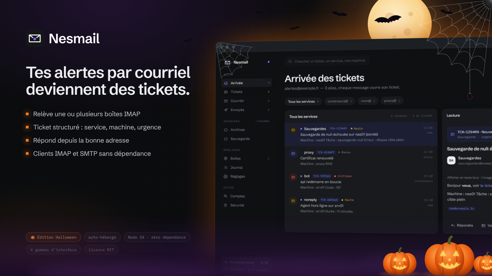
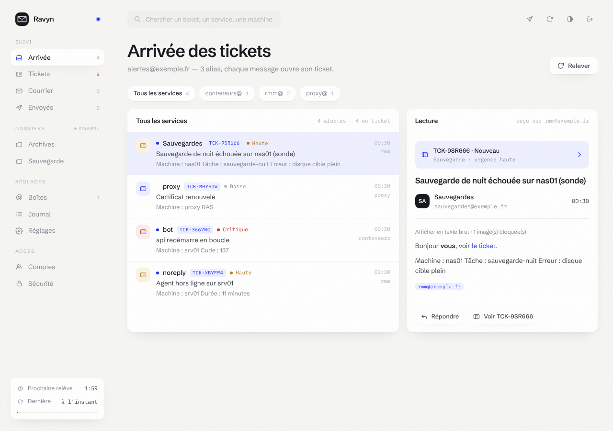
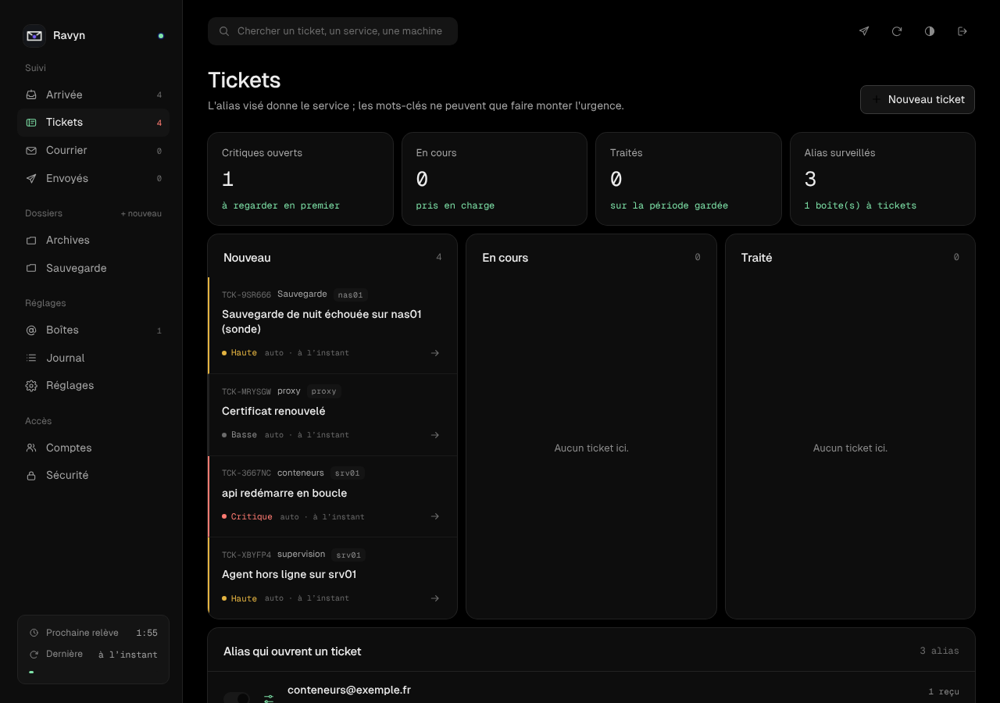
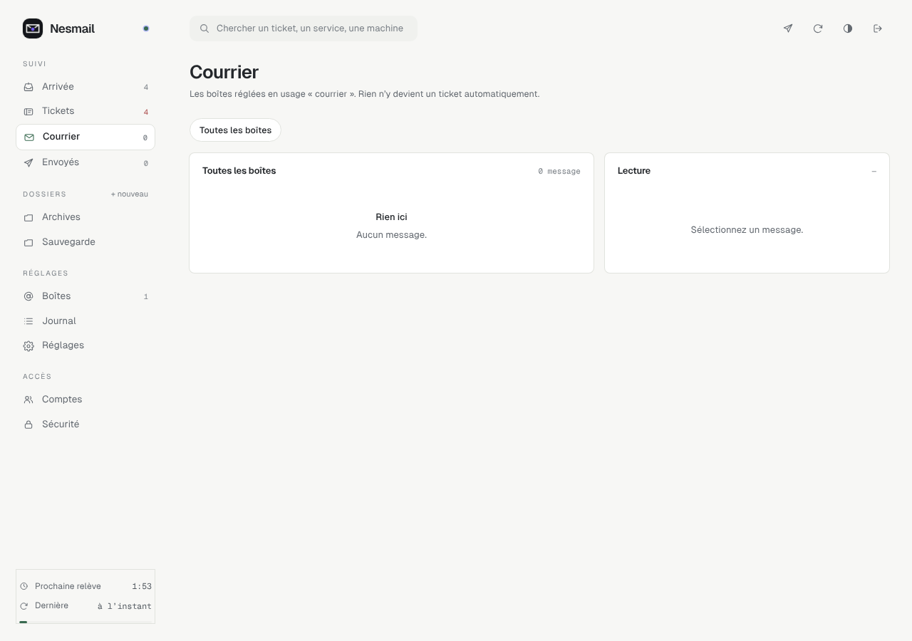
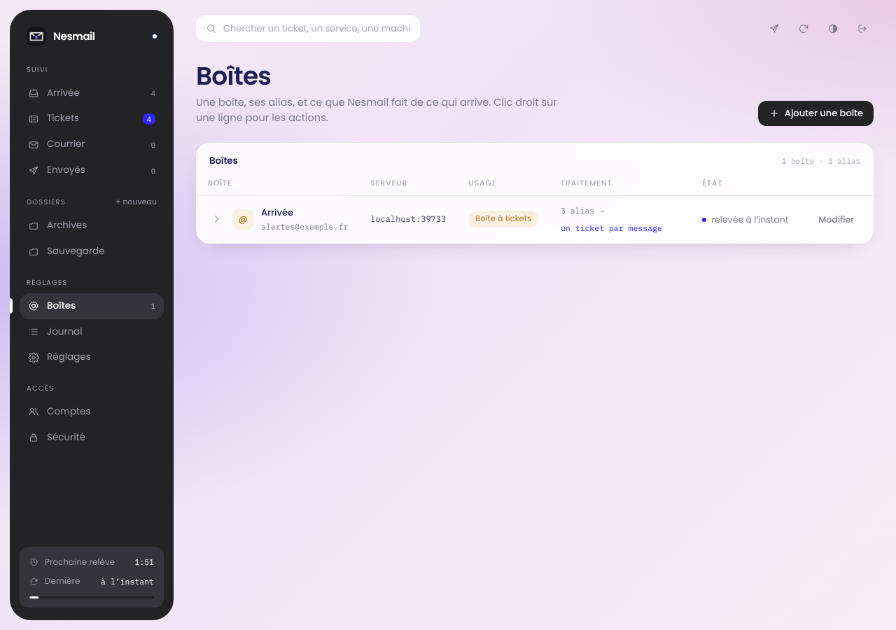

<p align="center"></p>

<p align="center"></p>

# Nesmail

**Self-hosted alert inbox: reads your IMAP mailboxes, turns every alert email into a structured ticket, and replies from the right address.**

<p align="center">

[](https://github.com/Nesaris/Nesmail/stargazers)
[](LICENSE)


</p>

<p align="center"><a href="README.fr.md">Full documentation</a> · <a href="https://nesaris.github.io">Nesaris Network</a></p>

## Why Nesmail?

Alerts from your servers, NAS and services end up drowned in an inbox. Nesmail turns them into deduplicated tickets with a service, a machine and an urgency — deterministically, no AI guessing.

## Features

- **One alias per service** — the alias an alert is sent to decides the service; no content guessing.
- **Urgency rules** — keywords can raise urgency (`offline`, `timeout` → high; `oom`, `panic`, `disk full` → critical), never lower it.
- **Deduplication** — repeated alerts increment the open ticket instead of creating new ones.
- **Sorting rules, outgoing webhooks and routes** to other services.
- **IMAP and SMTP clients written from scratch**, zero npm dependencies.
- **Accounts, roles, passkeys, TOTP** from the shared Nesaris core.

## Screenshots

<table>
<tr><td align="center" width="50%"><br><sub>Incoming alerts</sub></td><td align="center" width="50%"><br><sub>Tickets</sub></td></tr>
<tr><td align="center" width="50%"><br><sub>Mail</sub></td><td align="center" width="50%"><br><sub>Mailboxes</sub></td></tr>
</table>

## Quick start

```bash
git clone https://github.com/Nesaris/Nesmail && cd Nesmail
mkdir -p secrets && openssl rand -base64 32 > secrets/socle_cle && chmod 600 secrets/socle_cle
cp .env.example .env
docker compose up -d --build
docker compose logs nesmail | grep "Jeton d'installation"   # one-time setup token
```

Serve it over HTTPS behind a reverse proxy, paste the setup token and create the first account.

Full documentation (configuration, backups, key rotation, reverse proxy, upgrades) is in **[README.fr.md](README.fr.md)**.

## Part of Nesaris Network

Nesmail is one of the self-hosted tools of **[Nesaris Network](https://nesaris.github.io)**. Every service shares the same hardened core (accounts, passkeys, TOTP, audit log, encrypted secrets), runs on Node.js 24 with **zero npm dependencies**, and can be installed in one click from the **[Nesaris Hub](https://github.com/Nesaris/Hub)**.

Other projects: [Hub](https://github.com/Nesaris/Hub) · [MapMyLAN](https://github.com/Nesaris/MapMyLAN) · [NexArc](https://github.com/Nesaris/NexArc) · [ProxLab](https://github.com/Nesaris/ProxLab) · [Vigie](https://github.com/Nesaris/Vigie) · [Relay](https://github.com/Nesaris/Relay) · [Synapse](https://github.com/Nesaris/Synapse) · [Dialekt](https://github.com/Nesaris/Dialekt)

## Contributing

Issues and pull requests are welcome. If Nesmail is useful to you, a ⭐ helps a lot — it's how other people find the project.

## License

[MIT](LICENSE) — made by [CodeX64](https://codexx64.github.io).
