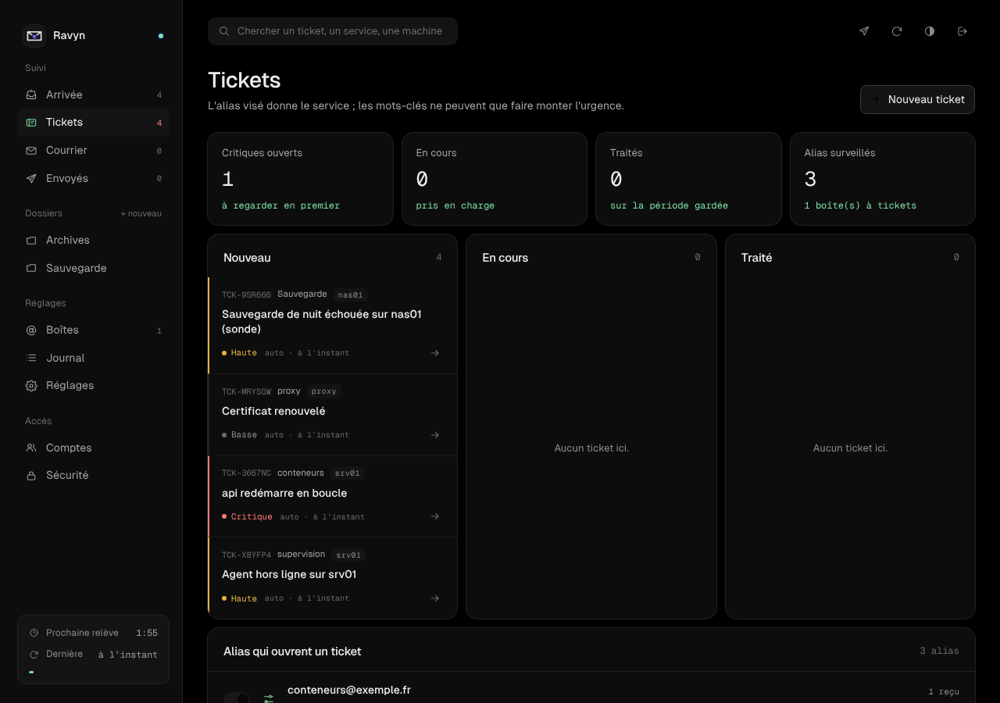
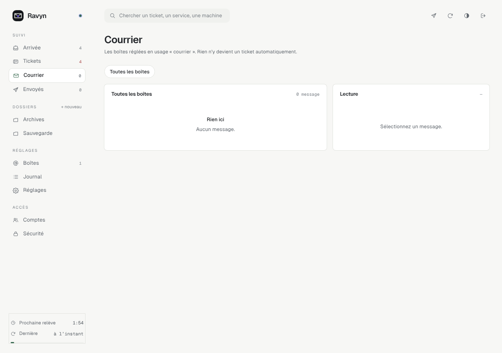
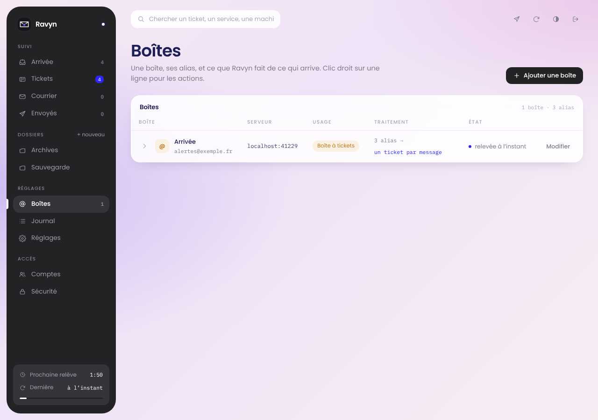
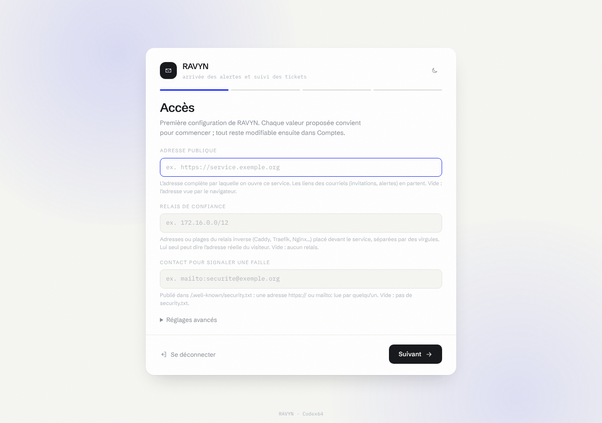

<p align="center"></p>

<p align="center"></p>

# Ravyn

Boîte d'arrivée des alertes et suivi des tickets. Relève une ou plusieurs boîtes
IMAP, transforme chaque alerte en ticket structuré (service, machine, urgence),
et répond depuis la bonne adresse.

Node 24, **aucune dépendance npm**. Clients IMAP et SMTP écrits à la main.
Comptes, sessions, second facteur, clés d'accès et thèmes viennent du socle
commun, embarqué dans `socle/` avec ses essais.

---

## Aperçu

|  |
|:--:|
| Les alertes arrivées (SOMA) |

|  |
|:--:|
| Les tickets (Console) |

|  |
|:--:|
| Le courrier (Exploitation) |

|  |
|:--:|
| Les boîtes (Lavande) |

Quatre gammes d’interface au choix — SOMA, Console, Exploitation, Lavande — en clair ou en sombre, de 360 à 1920 px de large.

## Le principe

Une boîte réglée en **boîte à tickets** possède un alias par service. L'alias
visé détermine le service : c'est déterministe, il n'y a rien à deviner dans le
contenu du message.

| alias | service | urgence par défaut |
|---|---|---|
| `conteneurs@exemple.fr` | conteneurs | critique |
| `supervision@exemple.fr` | supervision | haute |
| `proxy@exemple.fr` | proxy | basse |

Les mots-clés du message peuvent **faire monter** l'urgence, jamais la baisser.
`hors ligne`, `échec`, `timeout` passent en haute ; `boucle`, `oom`, `panic`,
`disque plein` passent en critique. Un « certificat renouvelé » arrivé sur un
alias réglé en basse reste en basse.

Deux alertes de même service, même machine et même objet dans la fenêtre de
dédoublonnage incrémentent le compteur du ticket ouvert au lieu d'en créer un
second.

---

## Installation par le Hub

RAVYN est une extension du Hub : **Extensions → RAVYN → Installer**. Le Hub
crée la clé maîtresse, le jeton de service et le jeton d'administration des
comptes, les garde dans son coffre, et construit l'image depuis ce dépôt si elle
n'est pas publiée. Le premier compte se crée depuis **Comptes des services**.

L'apparence suit la page **Thème** du Hub : SOMA, Console, Exploitation ou
Lavande, pour tous les services ou pour RAVYN seul. Clair ou sombre se règle
dans RAVYN, avec le bouton de l'en-tête.

## Installation seule

```bash
mkdir -p secrets && openssl rand -base64 32 > secrets/socle_cle && chmod 600 secrets/socle_cle
cp .env.example .env
docker compose up -d --build
docker compose logs ravyn | grep "Jeton d'installation"
```

Puis l'adresse de RAVYN, servie en HTTPS par un relais (Caddy, Traefik,
Relay…), le jeton d'installation, et le premier compte : identifiant, mot de
passe, clé d'accès, codes de secours. Les comptes suivants s'invitent depuis
**Comptes**.

La clé maîtresse (`secrets/socle_cle`) scelle les mots de passe des boîtes, les
clés d'API et les secrets TOTP : sans elle, une sauvegarde de la base ne rouvre
rien. Gardez-en une copie ailleurs que sur la machine.

Sans HTTPS, sur un réseau de confiance seulement : `SOCLE_HTTP=1` (mode
dégradé, affiché partout ; pas de clés d'accès, mot de passe et application
d'authentification pour l'administrateur).

### Variables

| variable | rôle |
|---|---|
| `SOCLE_CLE` / `SOCLE_CLE_FILE` | clé maîtresse, 32 octets en base64. **Obligatoire hors Hub** (sinon tirée dans le volume, à côté de ce qu'elle scelle). |
| `SOCLE_HTTP` | `1` : mode dégradé sans HTTPS. |
| `SOCLE_PROXYS` | relais autorisés à transmettre l'adresse du client (CIDR). |
| `SOCLE_URL_PUBLIQUE`, `SOCLE_SMTP_*` | alertes de sécurité des comptes par courriel. |
| `SOCLE_THEME` | `soma`, `console`, `exploitation` ou `lavande`. |
| `RAVYN_HUB_TOKEN` | jeton de service du Hub. |
| `RAVYN_ENVOIS_MINUTE` | envois par minute, toutes clés confondues (30). |
| `RAVYN_SECRET_V1` | reprise d'une 1.0 seulement (voir plus bas). |
| `RAVYN_DATA`, `PORT` | dossier des données (`/data`) et port interne (8787). |

---

## Première configuration et mises à jour

Au premier démarrage, ouvre l’interface : tu crées le compte administrateur avec
le jeton d’installation (affiché dans les journaux du conteneur, ou transmis par
le Hub), tu inscris tes facteurs de connexion, puis l’**assistant de
configuration** passe les réglages de RAVYN groupe par groupe. Il est
obligatoire : RAVYN reste fermé tant qu’il n’est pas terminé. Chaque valeur
proposée convient pour commencer.

<p align="center"></p>

Réglages demandés : courriels envoyés par minute au plus ; plus ceux de
tous les services (adresse publique, relais de confiance, gamme de
l’interface, contact de sécurité, courriels d’alerte).

Après une mise à jour qui apporte un réglage nouveau, l’assistant revient au
passage suivant d’un administrateur et ne demande **que ce réglage-là**. Une
mise à jour sans réglage nouveau ne demande rien : une fenêtre « Quoi de neuf »
résume ce qu’elle apporte, une fois par compte, et se ferme d’un clic
(`nouveautes.json`).

Tout reste modifiable dans **Comptes → Réglages du service**. Une variable
posée dans l’environnement l’emporte toujours et n’est pas demandée. RAVYN
redémarre seul pour appliquer un changement (le processus du conteneur le
supervise). Les valeurs vivent dans `reglages.json`, dans le volume de
données ; les secrets y sont scellés par la clé maîtresse.

## Les boîtes

**Boîtes → Ajouter une boîte** :

- l'adresse de la boîte de collecte, usage **Boîte à tickets** ;
- les serveurs IMAP et SMTP de votre fournisseur ;
- un alias par service, avec son urgence par défaut et son droit d'envoi ;
- **Tester** : la connexion est réellement vérifiée.

Le chiffrement n'est jamais facultatif : IMAP en TLS implicite (993) ou en
STARTTLS exigé (143), SMTP en TLS implicite (465) ou en STARTTLS exigé (587).
Un serveur qui ne propose pas STARTTLS ne reçoit ni mot de passe ni message.

Le certificat du serveur est vérifié par les autorités reconnues. Pour un
serveur auto-signé (Proton Bridge, serveur maison), **Tester** affiche
l'empreinte SHA-256 qu'il présente : vérifiez-la sur la machine, puis
**Épingler** ; seul ce certificat sera accepté ensuite.

## Règles de tri

**Réglages → Règles de tri.** Une règle s'applique à la relève, avant la
création du ticket.

Conditions sur l'expéditeur, le destinataire, l'objet, le corps, la boîte,
l'alias visé ou n'importe où. Opérateurs : contient, ne contient pas, est
exactement, commence par, finit par, expression régulière (200 caractères au
plus, sans quantificateur imbriqué ni référence arrière). Plusieurs conditions,
en mode « toutes remplies » ou « au moins une ». La comparaison ignore la casse
et les accents.

Actions : ranger dans un dossier, marquer lu ou non lu, forcer ou empêcher la
création du ticket, imposer une urgence ou un service, supprimer le message,
ou arrêter là.

**Essayer à blanc** passe la règle sur les 200 derniers messages et dit combien
elle aurait touchés, sans rien modifier.

---

## Comptes et rôles

| rôle | peut |
|---|---|
| lecture | tout voir |
| membre | traiter : tickets, dossiers, relève, accusés de réception, envoi |
| administrateur | régler : boîtes, règles, réglages, clés d'API, webhook, comptes |

Supprimer une boîte, changer où part son mot de passe, créer une clé d'API,
changer l'adresse du webhook ou le jeton Telegram demandent une confirmation
récente de son identité.

## Liaison avec un service externe

**Réglages → Liaison avec un service externe.** Deux clés distinctes :

- **la clé complète** (`pk_…`) lit et traite le courrier et les tickets, et envoie ;
- **la clé d'envoi** (`sk_…`) n'ouvre que `POST /api/send`.

Aucune clé n'existe tant qu'un administrateur ne l'a pas créée. Une clé se voit
**une fois**, à sa création : RAVYN n'en garde que l'empreinte. Perdue, elle se
régénère (l'ancienne cesse aussitôt). Aucune clé n'ouvre les boîtes, les règles,
les réglages ni les clés : cela demande une personne connectée. Les deux s'envoient en en-tête `X-Ravyn-Key`
ou en `Authorization: Bearer`. Le jeton de service du Hub vaut la clé complète.

Les **origines autorisées** ne servent que si un front appelle RAVYN depuis le
navigateur, avec une clé (jamais avec une session) ; `*` est refusé.

### Webhook sortant

```
POST <votre url>
X-Ravyn-Key: <clé>                    (nom de l'en-tête réglable)
X-Ravyn-Signature: sha256=<hmac du corps>

{ "event": "ticket.created", "ticket": { … }, "at": "…" }
```

Événements : `ticket.created`, `ticket.repeated` (dédoublonnage),
`ticket.updated` et `ticket.test`. Adresse en `http://` ou `https://`,
redirections jamais suivies.

### Routes

| méthode | route | effet |
|---|---|---|
| GET | `/api/health` | répond, sans rien dire d'autre (publique) |
| GET | `/api/summary` | tickets ouverts et critiques, non lus, boîtes en erreur |
| GET | `/api/tickets` | filtres `status`, `service`, `urgency`, `since`, `limit` |
| POST | `/api/tickets` | créer un ticket |
| PATCH | `/api/tickets/:id` | statut, urgence, notes |
| GET | `/api/messages/detailed` | messages avec service et urgence résolus (`new=1`, `since`) |
| POST | `/api/ack` | accuser réception de messages |
| GET | `/api/aliases` | alias et services déclarés |
| POST | `/api/send` | envoyer · clé d'envoi suffisante |

`GET /api` liste toutes les routes. Un client peut ranger ses appels sous son
propre préfixe (`/api/monservice/tickets`) : la route équivalente répond, avec
les mêmes droits.

## Faire envoyer vos services vers RAVYN

```
POST https://ravyn.exemple.fr/api/send
X-Ravyn-Key: sk_...

{ "from": "no-reply@exemple.fr", "to": "supervision@exemple.fr",
  "subject": "résumé court et stable du problème",
  "text": "Machine : srv01\n…" }
```

- un en-tête `Idempotency-Key` (8 à 100 caractères, lettres, chiffres, `-`, `_`)
  rend l'envoi sûr à rejouer : sous la même clé, pendant vingt-quatre heures, le
  message ne part qu'une fois et la réponse dit `"rejoue": true` ;
- une ligne `Machine : <hôte ou IP>` dans le corps devient la cible du ticket ;
- l'objet doit être **stable** pour un même incident : c'est lui qui sert au
  dédoublonnage. Horodatages et compteurs vont dans le corps.

---

## L'ancien nom : CACHET

RAVYN s'appelait CACHET. Rien n'est perdu au changement de nom :

- **par le Hub** : le catalogue propose RAVYN en mise à jour du CACHET installé ;
  le Hub copie le volume sous le nouveau nom, garde les réglages
  (`CACHET_ENVOIS_MINUTE` devient `RAVYN_ENVOIS_MINUTE`) et suit les routes ;
- **le volume** : `cachet.db` devient `ravyn.db` au premier démarrage, journaux
  compris, et sa table est renommée ; les secrets déjà scellés (mots de passe
  des boîtes, clés du webhook et de Telegram) s'ouvrent comme avant ;
- **un ancien `.env`** : chaque `CACHET_*` vaut encore pour le `RAVYN_*` du même
  nom, tant que celui-ci n'est pas posé ;
- **les services qui appellent l'API** : l'en-tête `X-Cachet-Key` est encore
  accepté, à côté de `X-Ravyn-Key` ;
- **les récepteurs du webhook** : la signature part sous `X-Ravyn-Signature` et
  sous `X-Cachet-Signature` ; un en-tête de clé réglé du temps de CACHET est
  gardé tel quel ;
- **une sauvegarde de CACHET** se restaure avec `node lib/cli.js restaurer`.

Les sessions ouvertes se referment une fois (le cookie porte le nom du
service) : on se reconnecte. Installé seul avec `docker compose`, le volume
s'appelle maintenant `ravyn-data` : copiez l'ancien avant le premier démarrage,
`docker run --rm -v <projet>_cachet-data:/de -v <projet>_ravyn-data:/vers busybox cp -a /de/. /vers/`.

## Reprendre une 1.0

Arrêtez la 1.0, gardez son volume, et démarrez la 2.0 sur ce volume avec
`RAVYN_SECRET_V1` = l'ancien `CACHET_SECRET` (dans le Hub : réglages avancés,
« CACHET_SECRET de la 1.0 »). Au premier démarrage, RAVYN reprend les boîtes,
les alias, les dossiers, les règles, les réglages, le courrier et les tickets ;
les mots de passe des boîtes sont rescellés sous la clé maîtresse, et les clés
d'API restent valables (vos services gardent l'accès) mais ne sont plus gardées
que par leur empreinte. `config.json` et
`state.json` sont renommés en `*.v1-reprise-<date>` : supprimez-les une fois la
reprise vérifiée, puis videz `RAVYN_SECRET_V1`.

Ce qui change :

- le mot de passe unique disparaît : le premier compte se crée par le jeton
  d'installation (ou depuis le Hub) ;
- une boîte réglée en « accepter un auto-signé » épingle le certificat vu à la
  connexion suivante ; une boîte « sans TLS » passe en STARTTLS exigé ;
- les clés d'API ne gèrent plus les boîtes, les règles ni les réglages ;
- les messages envoyés suivent la même durée de garde que les autres.
- les nouveaux tickets portent un numéro tiré au hasard (`TCK-7K3Q9X`), qui ne
  se devine pas et ne dit rien du volume d'alertes ; ceux de la 1.0 gardent le leur.

## Sauvegarde

```bash
docker exec -i ravyn node lib/cli.js sauvegarde < sauvegarde.pub > ravyn.sauv
node lib/cli.js restaurer sauvegarde.pem ravyn.db < ravyn.sauv   # ailleurs
```

Tout est dans `ravyn.db` (volume `/data`) : comptes, boîtes, règles, courrier,
tickets, journal. La sauvegarde est chiffrée pour une clé publique RSA dont la
clé privée ne vit pas sur la machine ; elle garde les secrets scellés sous la
clé maîtresse, à sauvegarder à part.

## Tourner la clé maîtresse

Dans le Hub, réglages avancés de RAVYN : la clé actuelle dans « Clé maîtresse
remplacée », une neuve (`openssl rand -base64 32`) dans « Clé maîtresse »,
redéployer. Au démarrage, les mots de passe des boîtes, les secrets du webhook
et de Telegram et les secrets TOTP sont rescellés sous la neuve (journal :
`coffre.tourne`). Vider ensuite « Clé maîtresse remplacée » et redéployer.
Installé seul : la neuve dans `secrets/socle_cle`, l'ancienne dans la variable
`SOCLE_CLE_ANCIENNE` du service (à ajouter dans `environment:`), le temps d'un
démarrage.

Une clé d'API se tourne depuis **Réglages → Liaison** : la nouvelle se voit une
fois, l'ancienne cesse aussitôt.

## Ce que ça fait, ce que ça ne fait pas

Fait : relève incrémentale par UID, MIME (multipart, base64, quoted-printable,
RFC 2047, en-têtes UTF-8), HTML nettoyé par liste blanche côté serveur puis
reconstruit côté navigateur, images distantes jamais chargées ; tickets,
escalade, dédoublonnage, historique ; règles, dossiers locaux, envoi, Telegram,
webhook signé ; purge à la rétention.

Pas fait, volontairement : OAuth2 (mot de passe d'application), pièces jointes
(le corps seul est extrait), plusieurs dossiers IMAP par boîte, dossiers côté
serveur (les dossiers sont locaux à RAVYN).

## Le premier message ne remonte pas ?

À la toute première relève, RAVYN ne prend que les messages **non lus**, pour
ne pas rejouer tout l'historique. **Relever depuis zéro** (clic droit sur la
ligne de la boîte) reprend les vingt derniers.

## Essais

```bash
node test/run.js                       # RAVYN (faux serveurs IMAP et SMTP, TLS réel)
node --test socle/test/                # le socle embarqué
node outils/parcours-navigateur.mjs    # chaque écran, chaque gamme, chaque largeur (Playwright)
```

---

MIT · CodexX64
